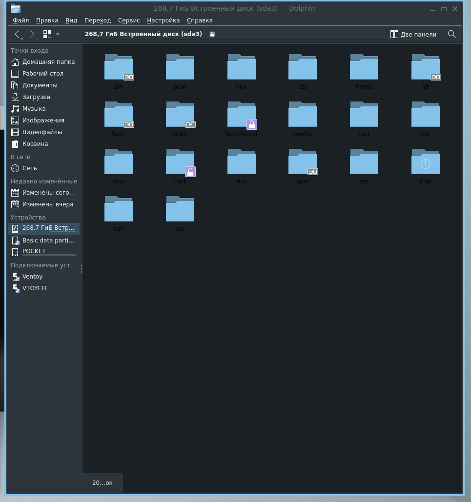
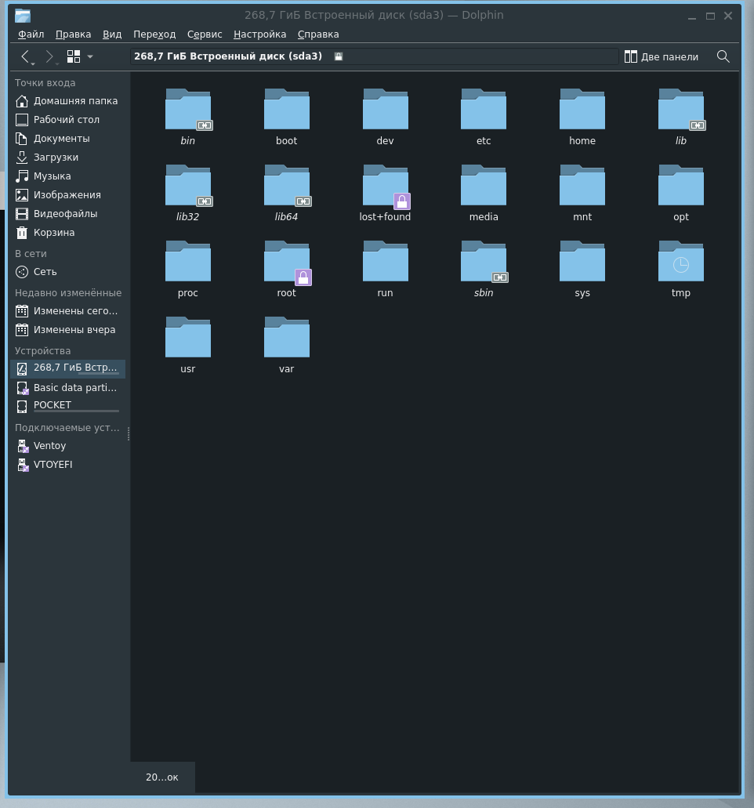

# Dolphin Dark Text Fix

Lightweight `LD_PRELOAD` fix for unreadable / pitch-black file and folder labels in **KDE Dolphin** (Qt 6) when running on Wayland compositors and window managers outside KDE Plasma (e.g. **Niri**, **Hyprland**, **Sway**, **i3**, **River**).

[Русское описание ниже](#описание-на-русском)

---

## The Problem

When running Dolphin outside of a full KDE Plasma session:
1. Dolphin sets the view background color to the dark background defined in `~/.config/kdeglobals`.
2. However, the file/folder icon view is rendered by `KItemListView` inside a `QGraphicsScene`.
3. `KItemListView` does not receive `QEvent::PaletteChange` events from Qt when theme changes occur, and inherits an uninitialized default Qt palette (`#000000` black text).
4. As a result, file and folder names appear as **black text on a dark background**, making them completely unreadable.

## Preview

| Before | After |
| :---: | :---: |
|  |  |

## The Solution

This lightweight C shim intercepts:
- `KStandardItemListWidget::textColor`: forces light readable text (`#f2f2f3`) while preserving selection highlights.
- `KStandardItemListWidget::updateAdditionalInfoTextColor`: sets secondary info (file size, dates) to readable muted gray (`#afb3b6`).
- `KItemListGroupHeader::textColor`: forces readable text on category headers.

---

## Quick Install

```bash
git clone https://github.com/potraxivatel/dolphin-dark-fix.git
cd dolphin-dark-fix
./install.sh
```

Or manually:
```bash
make
make install
```

This compiles `libdolphin_text_fix.so` to `~/.local/lib/` and sets up a launcher script in `~/.local/bin/dolphin`.

### Configuration (Optional)

You can customize colors using environment variables:

```bash
export DOLPHIN_TEXT_COLOR="#ffffff"       # Main text color (default: #f2f2f3)
export DOLPHIN_SUBTEXT_COLOR="#a0a0a0"    # Secondary text color (default: #afb3b6)
```

## Uninstall

```bash
./uninstall.sh
```

---

<a name="описание-на-русском"></a>
## Описание (на русском)

Легковесный фикс для исправления чёрного/нечитаемого текста на файлах и папках в **KDE Dolphin** при использовании тайлинговых оконных менеджеров и композиторов вне среды KDE Plasma (**Niri**, **Hyprland**, **Sway**, **i3** и др.).

### В чём была проблема?

Dolphin отрисовывает список файлов через `QGraphicsScene`. При работе вне Plasma движок `KItemListView` не получает сигнал смены темы от Qt и остаётся со стандартной светлой палитрой (чёрный текст `#000000`). При этом фон папок уже тёмный. Итог — чёрный текст на тёмно-сером фоне.

### Сравнение До и После

| До исправления | После исправления |
| :---: | :---: |
|  |  |

### Установка

```bash
git clone https://github.com/potraxivatel/dolphin-dark-fix.git
cd dolphin-dark-fix
./install.sh
```

Перезапустите Dolphin — текст станет белым и чётким!

## License

MIT
